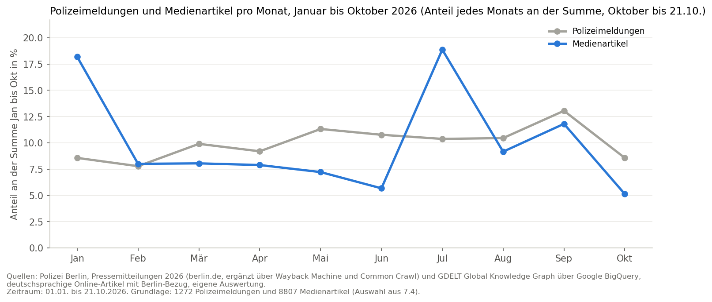
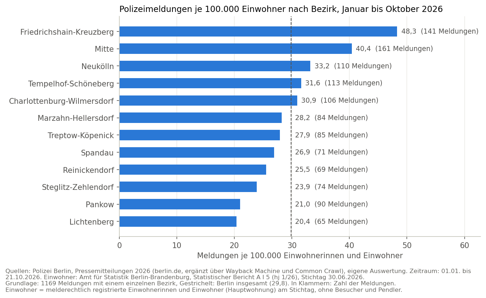

**Deutsch** | [English](README.en.md)

# OSINT Berlin 2026: Polizeimeldungen und Medien

**Python · SQLite · BigQuery · lokale KI · Streamlit**

Lagebild der öffentlichen Sicherheit in Berlin von Januar bis Oktober 2026, nur aus offenen Quellen. Grundlage sind
**1.272 Pressemitteilungen der Polizei Berlin** und **8.807 deutschsprachige Online-Artikel** zu Polizei und
Kriminalität in Berlin aus dem GDELT Global Knowledge Graph. Das Projekt zeigt, worüber die Polizei berichtet, wann und
in welchen Bezirken, und wo sich Polizeimeldungen und Medienberichterstattung unterscheiden.

**[Interaktives Dashboard öffnen](LINK FOLGT)** · [Notebook](osint_berlin_2026.ipynb)



**Drei Ergebnisse auf einen Blick**
- Polizei und Medien laufen nicht gleich: Die Wochenwerte hängen nicht zusammen (Pearson -0,21, Spearman -0,01). Zum Anschlag im Umfeld des CSD gibt es eine Polizeimeldung, aber 961 Medienartikel.
- Je Einwohner liegt Friedrichshain-Kreuzberg vorn (48,3 Meldungen je 100.000 Einwohner, Berlin 29,8). Pankow fällt von Rang 6 nach der Zahl der Meldungen auf Rang 11 je Einwohner.
- Die Polizei veröffentlicht gleichmäßig über das Jahr, die Medien folgen großen Ereignissen: Januar und Juli bringen zusammen mehr als ein Drittel aller Artikel.

> **Einordnung:** Polizeimeldungen sind keine Kriminalstatistik. Die Polizei veröffentlicht nur eine Auswahl ihrer
> Fälle. Das Projekt beschreibt, was veröffentlicht wird, nicht, wie viel Kriminalität es gibt. Details:
> [Einordnung und Hinweise](#einordnung-und-hinweise).

---

## Fragestellung

1. Worüber berichtet die Polizei Berlin, und wie verteilen sich die Meldungen auf Themen?
2. Wie verändert sich die Zahl der Meldungen im Jahresverlauf, und erzeugen große Ereignisse (Brandanschlag auf das Stromnetz im Januar, 1. Mai, Anschlag im Umfeld des CSD im Juli, Wahl zum Abgeordnetenhaus im September) sichtbare Spitzen?
3. Welche Bezirke und Orte kommen in den Meldungen besonders häufig vor?
4. Wo unterscheiden sich Polizeimeldungen und Medienberichterstattung?

## Datenbasis

| | |
|---|---|
| Zeitraum | 01.01. bis 21.10.2026 (Oktober unvollständig) |
| Polizeimeldungen | 1.272 nach Bereinigung, geschätzte Abdeckung 90,8 % über die Meldungsnummern |
| Medien | 132.636 deutschsprachige Online-Artikel mit Berlin-Bezug, davon 8.807 zu Polizei und Kriminalität aus 232 Quellen |
| Einwohner und Umfeld | Amt für Statistik Berlin-Brandenburg: Einwohnerregister (30.06.2026) und Mikrozensus 2025 |
| Sprache | Deutsch |

---

## Aufbau

Das ganze Projekt steht in einem Notebook mit nummerierten Abschnitten, Interpretationen, Limitations und Quellen.

| Nr. | Abschnitt | Inhalt |
|---|---|---|
| 1 | Projektüberblick | Ziel, Leitfragen, Datenerhebung |
| 2 | Datenüberblick | Umfang, fehlende Werte, Vollständigkeit über die Meldungsnummern, Duplikate |
| 3 | Bereinigung | Duplikate, technische Reste, Zeitspalten, Ereignisorte |
| 4 | Kategorisierung | Regeln und lokales Sprachmodell, Modellvergleich, manuelle Stichprobe |
| 5 | Zeitverlauf | Meldungen pro Tag, die vier Ereignisse, Wahlkampf, Themen, Gewalt gegen Polizei |
| 6 | Bezirke und Orte | Meldungen je Einwohner, Umfeld der Bezirke, Orte aus dem Text, kriminalitätsbelastete Orte, Karte |
| 7 | Medien | GDELT über BigQuery, Auswahl über den Titel, Kategorien, Themen, Orte, Quellen |
| 8 | Vergleich | Kategorien, Zeitverlauf, Ereignisse, Themen, Orte, Gewalt gegen und durch die Polizei |
| 9 | Dashboard | Export der Tabellen, Start des Dashboards |

### Datenerhebung
- Drei eigene Skripte, alle schreiben in eine SQLite-Datenbank:
  - `scrape_polizeimeldungen.py`: Archiv 2026 auf berlin.de (988 Meldungen, mit Uhrzeit)
  - `find_missing_meldungen.py`: Wayback Machine, Common Crawl und Unterseiten (143 weitere Meldungen)
  - `id_scan.py`: direkter Abruf über die Meldungs-ID (146 weitere Meldungen)
- Grund: Das offizielle Archiv listet nicht alle Meldungen. Die höchste Meldungsnummer bis zum 21.10.2026 ist 1399, im Archiv standen nur 988 Einträge, und der Juni fehlte fast ganz.
- Alle Abrufe mit Pausen zwischen den Anfragen und nach Prüfung der robots.txt.

### Kategorisierung
- 12 Kategorien, zuerst über Regeln (Suchwörter), dann mit einem **lokal betriebenen Sprachmodell** (`Ollama`). Die Meldungen werden nicht an eine Cloud gesendet.
- Vier Modelle im Vergleich: Gemma 4 (26B), Mistral Small 3.1, Qwen 3.6, Gemma 2
- Geprüft an 100 manuell kategorisierten Meldungen: Regeln 83 % richtig, Modelle 89 bis 94 %
- **Gewähltes Modell: Gemma 4**, gleich genau wie Mistral, aber mehr als dreimal so schnell
- Größter Gewinn bei „Politisch motiviert“: Der Hinweis auf ein Motiv oder den Staatsschutz steht oft erst am Ende des Textes. Nach dem Modell sind 13 % der Meldungen politisch motiviert, nach den Regeln nur 7 %.

### Medien
- GDELT Global Knowledge Graph über Google BigQuery, gefiltert auf deutschsprachige Artikel mit Berliner Ort
- Auswahl über den Titel: Berlin-Bezug (Berlin, Bezirke, Orte aus Abschnitt 6) und ein Wort zu Polizei oder Kriminalität
- Dieselben Regeln wie bei der Polizei, damit beide Seiten vergleichbar sind
- Die GDELT-DOC-API war wegen Sperren nicht nutzbar, das steht im Notebook (7.1)

### Bezirke und Umfeld



- Neben den Meldungen je Einwohner steht für jeden Bezirk: Bevölkerung nach Staatsangehörigkeit und Migrationshintergrund, Haushaltsnettoeinkommen sowie Erwerbstätige und Erwerbslose
- Friedrichshain-Kreuzberg, Mitte und Neukölln liegen bei allen drei Merkmalen vorn und haben zugleich die meisten Meldungen je Einwohner. Ohne Friedrichshain-Kreuzberg und Mitte zeigt keines der Merkmale einen gesicherten Zusammenhang.
- Der Vergleich gilt für Bezirke, nicht für Personen (siehe [Einordnung und Hinweise](#einordnung-und-hinweise))

### Dashboard
- Interaktive Grafiken mit `Plotly` in einer `Streamlit`-App, auf Deutsch und Englisch: [Dashboard öffnen](LINK FOLGT)
- Unter jedem Diagramm stehen Quelle, Zeitraum, Grundlage und die Erklärung der Begriffe
- Liest nur die fertigen Tabellen aus `dashboard/data/` (Zahlen, keine Texte von Meldungen oder Artikeln); lokal: `streamlit run dashboard/app.py`

---

## Tech-Stack

| Bereich | Werkzeuge |
|---|---|
| Sprache & Umgebung | Python, Jupyter, conda, Linux |
| Datenerhebung | Requests, Beautiful Soup, Wayback Machine CDX API, Common Crawl Index |
| Datenbank | SQLite |
| Medien | Google BigQuery (GDELT GKG), google-cloud-bigquery |
| Analyse | pandas, NumPy |
| Lokale KI | Ollama (Gemma 4, Mistral Small 3.1, Qwen 3.6, Gemma 2) |
| Karte & Geodaten | folium, OpenStreetMap Nominatim, Geodatenportal Berlin |
| Visualisierung | matplotlib; Plotly, Streamlit |

---

## Projektstruktur

```
berlin_osint_2026/
├── README.md                  ← deutsche Version
├── README.en.md               ← englische Version
├── osint_berlin_2026.ipynb    ← das ganze Projekt
├── scrape_polizeimeldungen.py ← Archiv auf berlin.de
├── find_missing_meldungen.py  ← Wayback Machine, Common Crawl
├── id_scan.py                 ← Abruf über die Meldungs-ID
├── images/                    ← zwei Diagramme für die README
├── dashboard/
│   ├── app.py                 ← Streamlit-App
│   ├── i18n.py                ← alle Texte auf Deutsch und Englisch
│   ├── requirements.txt       ← Pakete des Dashboards
│   └── data/                  ← Tabellen aus Abschnitt 9.1, nur Zahlen
└── data/                      ← Rohdaten, Datenbank und Volltexte (nicht im Repository)
```

---

## Einordnung und Hinweise

> **Keine Kriminalstatistik:** Die Polizei veröffentlicht nur eine Auswahl ihrer Fälle, vor allem solche mit
> öffentlichem Interesse oder Zeugenaufruf. Gezählt werden Meldungen und Artikel, nicht Fälle. Für Fallzahlen ist
> die Polizeiliche Kriminalstatistik (PKS) die richtige Quelle.

> **Bezirke, nicht Menschen:** Die Vergleiche mit Bevölkerung, Einkommen und Erwerbslosigkeit beschreiben das
> Umfeld der Bezirke. Sie zeigen nicht, wer Taten begeht oder Opfer wird. Polizeimeldungen nennen die Herkunft von
> Beteiligten nur selten, und viele Beteiligte wohnen nicht im Bezirk. Mit 12 Bezirken lassen sich Lage in der
> Innenstadt, Besucher, Herkunft und soziale Lage nicht voneinander trennen.

> **Medien über den Titel:** Medienartikel werden nur über ihren Titel ausgewählt und eingeordnet, Polizeimeldungen
> über Titel und Text. Über einen Fall erscheinen oft Dutzende Artikel, eine hohe Zahl an Artikeln heißt deshalb
> nicht, dass es viele Fälle gab.

> **Wortwahl:** Die Auswertung bewertet nichts politisch. Bei laufenden Verfahren gelten Beschuldigte als
> mutmaßliche Täter. Ob ein Einsatz der Polizei rechtmäßig war, lässt sich aus Meldungen und Titeln nicht ablesen.

Alle Grenzen im Einzelnen: Abschnitt „Limitations“ im Notebook.

---

## Datenschutz & Urheberrecht

- ausschließlich **öffentlich zugängliche** Pressemitteilungen, Artikel-Metadaten und amtliche Statistiken
- Die Volltexte der Polizeimeldungen und die Medienartikel sind **nicht Teil des Repositorys**, weil die Meldungen teils Beschreibungen von Personen enthalten (z. B. Vermisstenfälle) und die Artikel urheberrechtlich geschützt sind. Auf GitHub stehen nur Auswertungen.
- Das Dashboard enthält nur Zahlen, keine Titel und keine Texte
- Kategorisierung mit dem Sprachmodell läuft **lokal**
- Keine Zugangsdaten im Code: Die Anmeldung bei BigQuery läuft über den Google-Login im Browser. Rohdaten sind vom Repository ausgeschlossen.

## Kompetenzen, die das Projekt zeigt

- Web Scraping mit mehreren Wegen, wenn eine Quelle unvollständig ist (Archiv, Wayback Machine, Common Crawl, ID-Abruf)
- Datenqualität: Vollständigkeit messen, Lücken und Duplikate finden, Grenzen dokumentieren
- SQL mit SQLite und großen Abfragen in BigQuery (mit Probelauf und Zwischenspeicher)
- Einsatz und **Prüfung** lokaler KI: Modellvergleich an einer manuellen Stichprobe
- Geodaten: Orte aus dem Text, Koordinaten, Karte, Verknüpfung mit amtlichen Statistiken
- Quellenkritischer Vergleich von Polizeimeldungen und Medien
- Zweisprachiges Dashboard für Leser ohne Vorkenntnis

## Status

Alle neun Abschnitte sind fertig. Das Notebook wird bei Bedarf ergänzt und korrigiert.

---

## Wichtigste Quellen

- Polizei Berlin: Polizeimeldungen, Archiv 2026. https://www.berlin.de/polizei/polizeimeldungen/archiv/2026/
- GDELT Project: Global Knowledge Graph 2.1 in Google BigQuery. https://www.gdeltproject.org/data.html
- Amt für Statistik Berlin-Brandenburg: Statistischer Bericht A I 5 (hj 1/26), Einwohnerregisterstatistik Berlin 30. Juni 2026. https://www.statistik-berlin-brandenburg.de/a-i-5-hj
- Amt für Statistik Berlin-Brandenburg: Ergebnisse des Mikrozensus in Berlin 2025 (Erstergebnis). https://www.statistik-berlin-brandenburg.de
- Polizei Berlin: Kriminalitätsbelastete Orte in Berlin. https://www.berlin.de/polizei/polizeimeldungen/fakten-hintergruende/artikel.1078268.php
- Geodatenportal Berlin: ALKIS Berlin Bezirke, Datenlizenz Deutschland Zero 2.0. https://gdi.berlin.de/services/wfs/alkis_bezirke
- OpenStreetMap: Nominatim, Daten © OpenStreetMap-Mitwirkende (ODbL). https://nominatim.openstreetmap.org/

Alle Quellen: Abschnitt „Quellen“ im Notebook.

---

## Rechte

© 2026 Amirhoushang Rahmannejad. Alle Rechte vorbehalten. Ansehen und Prüfen ist ausdrücklich erwünscht. Kopieren, Ändern oder Weiterverbreiten nur mit meiner schriftlichen Erlaubnis.
